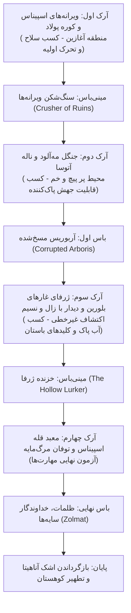

# افسانه اسپیناس: اشک آناهیتا
## سند جامع داستان، جهان‌سازی، کاراکترها، مأموریت‌ها و سناریوی مترویدوانیا (Game Story & Narrative Bible)

---

## ۱. پیش‌زمینه و جهان‌داستانی (Lore & World-Building)

### ۱.۱. روستای پلکانی اسپیناس و کوهستان مقدس
در دامنه‌های مه‌گرفته و سر به فلک کشیده‌ی رشته‌کوه اسپیناس، روستایی پلکانی و سنگی با بام‌های کاه‌گلی قرار دارد. این دیار قرن‌ها در پناه برکت **«اشک آناهیتا»** زیسته است؛ سنگی فیروزه‌ای، درخشان و مقدس که در بالاترین تالار معبد قله نگهداری می‌شد. این گوهر، سرچشمه‌ی جویبارهای زلال، سرسبزی جنگل‌های انبوه، و دمنده‌ی حیات پاک به کالبد ساکنان و حیات‌وحش کوهستان بود.

### ۱.۲. یورش ظلمات و فساد مرگ‌مایه
قرن‌ها سکوت کوهستان با بیداری **ظلمات (Zolmat)** شکسته شد. ظلمات، ساحر باستانی و تشنه‌ی جاودانگی، از فراموش‌خانه‌ی تاریخ برخاست و با ارتش سایه‌ها به معبد هجوم برد. او با ربودن سنگ فیروزه‌ای آناهیتا و فاسد کردن انرژی آن، زهر پیچنده‌ای موسوم به **«مرگ‌مایه» (Marg-mayeh)** را در شریان‌های اسپیناس جاری ساخت:
- چشمه‌های مقدس خشکیدند و به مرداب‌های سمی بنفش بدل گشتند.
- خارهای غول‌آسا، گزنده و بنفش‌رنگ از دل سنگ‌ها و دیوارها سر برآوردند و کوچه‌ها، پل‌ها و گذرگاه‌ها را مسدود کردند.
- حیوانات کوهستان و موجودات نگهبان طبیعت، مسخ شده و به هیولاهایی سایه‌گون با چشمانی درخشان و پوستی پوشیده از خار بدل شدند.
- روستا به ویرانه‌ای خاموش و دودگرفته بدل شد و نجات‌یافتگان اندک در گوشه‌های پنهان پناه گرفتند.

---

## ۲. قهرمانان برگزیده (Protagonists)

بازیکن در ابتدای بازی یکی از دو قهرمان زیر را برمی‌گزیند. داستان در هسته اصلی یکسان است، اما تعاملات، زوایای دید و مکانیزم‌های حرکتی متناسب با شخصیت انتخاب‌شده دستخوش تغییر می‌شود:

```
+-----------------------------------------------------------------------------------+
| قهرمان اول: بردیا (Bardia)                                                        |
+-----------------------------------------------------------------------------------+
| • کهن‌الگو: شاگرد آهنگر، مبارز متکی به قدرت بدنی و نبرد نزدیک (Melee Specialist)   |
| • سلاح و ادوات:                                                                   |
|   - مچ‌بند سنگی فیروزه‌ای (Wristband of Light): تقویت مشت‌ها و ضربات با هاله نور     |
|   - قلاب برنزی پیشرفته (Grappling Hook): تاب خوردن از حلقه‌ها و صعود به لبه‌های دور  |
| • سبک شخصیتی: صبور، استوار، وفادار به استادش پولاد، معتقد به کار سخت و اراده پولادین|
+-----------------------------------------------------------------------------------+
| قهرمان دوم: روژان (Rojan)                                                         |
+-----------------------------------------------------------------------------------+
| • کهن‌الگو: دیده‌بان و تک‌تیرانداز بادهای اسپیناس، چابک و دورزن (Ranged Specialist) |
| • سلاح و ادوات:                                                                   |
|   - کمان چوبین کهن (Nature Bow): پرتاب تیرهای انرژی آمیخته به باد و جادوی پاک     |
|   - چابکی باد: پرش جفت (Double Jump) و جهش از دیواره‌ها (Wall Jump)                 |
| • سبک شخصیتی: تیزبین، آزاداندیش، دل‌بسته به نجواهای کهن جنگل و دارای حس مسؤلیت عمیق|
+-----------------------------------------------------------------------------------+
```

---

## ۳. شخصیت‌های مکمل و راهنما (NPCs)

### ۳.۱. استاد پولاد (Master Poolad) — کوره آهنگری زیرزمینی
- **نقش:** مربی، آهنگر ارشد، سیستم ارتقای سلاح و زره، و لنگرگاه امید بازماندگان.
- **ظاهر:** پیرمردی تنومند با ریش‌های خاکستری، پیش‌بند چرمی سوخته و پتکی سنگین در دست که در کوره‌ای امن زیر آوارها سنگر گرفته است.
- **عملکرد بازی:** ارتقای قدرت ضربات سلاح، کاهش زمان بازیابی قلاب بردیا یا افزایش ظرفیت تیرهای سریع روژان در ازای قطعات باستانی (Ancient Scrap).

### ۳.۲. آتوسا (Atousa) — قلب مه‌آلود جنگل
- **نقش:** نگهبان کهن‌سال طبیعت اسپیناس و تجلی روح جنگل.
- **ظاهر:** زنی اثیری و باوقار که نیمی از بدنش با خارهای بنفش مرگ‌مایه بر تنه درختی تنومند و کهن گره خورده و با درد جانکاهی زنده است.
- **مأموریت اصلی:** درخواست «جام آب پاک» از اعماق غارها پیش از تسلیم شدن کامل به تاریکی. پاداش مأموریت: باز شدن گره‌های بنفش و دریافت مهارت پاک‌سازی خارها.

### ۳.۳. زال کهنسال (Old Zal) — استراحتگاه غارهای بلورین
- **نقش:** فرزانه نابینا، پاسدار خاطرات گذشته، نقطه ذخیره امن (Save & Lore Hub).
- **ظاهر:** درویشی سپیدموی با چشم‌بندی پارچه‌ای که در کنار آتشی آرام نشسته و نوای سرودهای باستانی را زیر لب زمزمه می‌کند.
- **عملکرد بازی:** روایت افسانه‌های تاریک ظلمات، فاش کردن نقاط ضعف باس‌ها و تقویت روح قهرمان با افزایش نوار انرژی معنوی.

### ۳.۴. نسیم (Nasim) — دختر دوره‌گرد و تاجر پرتگاه‌ها
- **نقش:** فروشنده شوخ‌طبع، نترس و جسورِ کالاهای نایاب و کلیدها.
- **ظاهر:** دختری جوان با شال و کلاه کوهستانی، کوله‌پشتی بزرگ و خنجری بر شال کمر که بی‌پروا بر خطرناک‌ترین پرتگاه‌های غار مستقر می‌شود.
- **کالاها:**
  - **انار طلایی (Golden Pomegranate):** افزایش دائمی یک واحد به بیشینه سلامتی (HP Heart Container).
  - **کلیدهای باستانی برنزی و سیمین:** باز کردن درهای مخفی معبد و صندوقچه‌های فراموش‌شده.

---

## ۴. ساختار آرک‌های داستانی و پیشروی بازی (Story Arcs & Metroidvania Loop)



---

### آرک اول: بیداری در خاکستر و کوره زیرزمینی (Act I: The Ruined Terraces & Underground Forge)

#### محیط و اتمسفر
- **نام منطقه:** ویرانه‌های پلکانی اسپیناس (The Ruined Terraces)
- **پالت رنگی:** دودی، خاکستری، آجر پخته و لکه‌های نئونی بنفش خارهای مرگ‌مایه.
- **رویداد آغازین:** قهرمان پس از شبی هولناک در خرابه‌های خانه‌اش به هوش می‌آید. صدای ناله‌های باد در میان کوچه‌های سنگ‌فرش پیچیده است. قهرمان باید از لبه‌های ویران پایین برود تا به ورودی کوره زیرزمینی برسد.

#### دشمنان عادی منطقه:
1. **خفاش‌های تیغ‌بنفش (Needle Bats):** پرواز در الگوهای سینوسی، هجوم ناگهانی هنگام نزدیک شدن بازیکن.
2. **سایه‌گرگ‌های فاسد (Blighted Wolves):** جهش‌های سریع، گاز گرفتن و رها کردن مه سمی کوتاه‌مدت.
3. **پوچ‌شدگان روستا (Hollow Villagers):** روستاییانی که جسمشان تسلیم ریشه‌ها شده، حملات کند اما ضربات سنگین کلنگ و بیل زنگ‌زده.

#### مینی‌باس آرک اول: **«سنگ‌شکن ویرانه‌ها» (Crusher of the Ruins)**
- **معرفی:** مجسمه سنگی عظیمی از معماران قدیم روستا که مرگ‌مایه در مفاصل آن نفوذ کرده و آن را به ماشینی خشن تبدیل کرده است.
- **میدان نبرد:** حیاط خلوت کوره آهنگری که با دیوارهای کاه‌گلی محصور است.
- **الگوهای حمله:**
  - *کوبش دست (Ground Slam):* موج شوک کوچکی روی زمین به چپ و راست می‌فرستد که نیازمند پرش به موقع است.
  - *پرتاب قلوه‌سنگ (Rock Fling):* کندن سنگ از زمین و پرتاب به سمت موقعیت قهرمان.
  - *شارژ غول‌آسا (Wild Charge):* دویدن مستقیم به سمت دیوار که با برخورد سرش، مدتی گیج می‌شود و فرصت آسیب‌پذیری ایجاد می‌کند.
- **پاداش شکست:** دستیابی به «قطعه چرخ‌دنده باستانی» که استاد پولاد با آن کوره اصلی را روشن می‌کند و قلاب برنزی بردیا / ارتقای تیر روژان را تکمیل می‌نماید.

#### دیالوگ‌های کلیدی آرک اول:
> **استاد پولاد (با پتک بر سندان می‌کوبد، چشم در چشم قهرمان):**
> «برخاستی؟ گمان می‌کردم زیر بار سنگین این آوارها خاکسترت هم پیدا نشود پسر/دختر! ببین به چه روزی افتادیم... اسپیناس زنده در آتش خشم ظلمات می‌سوزد. چشمه‌های مقدس دیگر جرعه‌ای آب پاک نمی‌جوشند. مچ‌بندت هنوز می‌سوزد، نه؟ سنگش نشانی از همان گوهر گم‌شده دارد. اگر می‌خواهی به قله برسی و آن عفریت سیاه را به زیر بکشی، باید استخوانت از فولاد و خشمت از آتشِ کوره‌ام گرم‌تر باشد. این سلاح را بگیر، اما گوش دار: هر قطعه باستانی یا آلیاژی که در خرابه‌ها یا شکم این جانوران یافتی، مستقیم برای من بیاور. بدون زره مناسب، در بادهای سوزان قله حتی به درگاه معبد هم نخواهی رسید!»

---

### آرک دوم: جنگل مه‌آلود و ناله آتوسا (Act II: The Misty Forest & The Entangled Guardian)

#### محیط و اتمسفر
- **نام منطقه:** جنگل مه‌آلود (The Misty Forest) و بیشه‌های خزان‌زده.
- **پالت رنگی:** سبز تیره، زیتونی بیمارگونه، مه متراکم شیری‌رنگ، رگه‌های درخشان ارغوانی.
- **گیم‌پلی محیطی:** پلتفرم‌های قارچی ارتجاعی، شاخه‌های شکننده، چشمه‌های اسیدی حاصل از ترشحات مرگ‌مایه.

#### دشمنان منطقه:
1. **پیچک‌های جهنده (Root Stalkers):** دشمنانی گیاهی که از زیر خاک ناگهان شلیک شده و سنبله‌های خاری پرتاب می‌کنند.
2. **کلاغ‌های مه (Mist Ravens):** فریب قهرمان با شیرجه‌های زاویه‌دار و کم‌رنگ شدن در مه.
3. **اسپورهای انفجاری (Spore Crawlers):** قارچ‌های متحرکی که با رسیدن به قهرمان پس از ۱ ثانیه متورم شده و منفجر می‌شوند.

#### رویداد داستانی آتوسا:
در عمیق‌ترین بخش بیشه مقدس، قهرمان به آتوسا می‌رسد. ریشه‌های ضخیم بنفش دور نیم‌تنه او پیچیده‌اند و نور فیروزه‌ای بدنش به سیاهی می‌گراید.
> **آتوسا (با صدایی چون نجوای برگ‌های پاییزی):**
> «صدای گام‌هایت را از میان ریشه‌های رنجور زمین می‌شنیدم، فرزند کوهستان... نگاه کن، مرگ‌مایه بندبند وجودم را می‌خشکاند. ظلمات می‌داند که اگر قلب جنگل از تپش بایستد، راه معبد برای همیشه در چنگال مه‌ سیاه گم خواهد شد... من هنوز با آخرین تارهای جانم راه را نگه داشته‌ام، اما تابم رو به پایان است. 
> به اعماق غارهای بلورین زیرین برو... آنجا، در تاریک‌ترین ژرفا، چشمه‌ای باستانی هست که قطراتش هنوز خنکای دست آناهیتا را در خود دارد. جامی از آن آب زلال برایم بیاور تا ریشه‌های این طلسم را بسوزانم. عجله کن... سیاهی دارد پلک‌هایم را برای همیشه سنگین می‌کند...»

#### باس آرک دوم: **«آربوریس مسخ‌شده» (Corrupted Arboris)**
- **پیش‌زمینه:** درختی غول‌آسا و نگهبان کهن جنگل که مغزش توسط کریستال بنفش مرگ‌مایه آلوده شده و از ورودی غارها نگهبانی می‌کند.
- **فاز ۱ (روی زمین):** ضربات سهمگین ریشه‌ها از کف زمین، چرخش شاخه‌های تیغ‌دار.
- **فاز ۲ (تندباد مه):** پرتاب گلوله‌های اسیدی، رها کردن غبار سمی که بازیکن را وادار به جاخالی دادن روی پلتفرم‌های بالایی می‌کند.
- **نقطه ضعف:** کریستال ضربان‌دار بنفش پشت سرش؛ بردیا با قلاب پشت او فرود می‌آید و روژان با شلیک زاویه‌دار دیواری به آن آسیب می‌زند.
- **پاداش:** باز شدن دهانه «غارهای بلورین» و دریافت «پوسته آربوریس» جهت ارتقای زره.

---

### آرک سوم: ژرفای غارهای باستانی و نغمه سایه‌ها (Act III: The Sunken Crystal Caverns)

#### محیط و اتمسفر
- **نام منطقه:** غارهای تاریک بلورین و آبراه‌های مخفی (Sunken Crystal Caverns).
- **پالت رنگی:** فیروزه‌ای تیره، بنفش سیر، بازتاب بلورهای شب‌تاب روی آب‌های ساکن.
- **مکانیک‌های محیطی:** مناطق تاریک که تنها با حمله نوری قهرمان روشن می‌شوند، آویزهای استالاکتیت که در اثر لرزش فرو می‌ریزند.

#### کاراکترهای مستقر در غار:

```
[زال کهنسال در کنار آتش استراحتگاه]
               │
               ▼
"چشم سر بسته‌ام و راز جهان می‌بینم..."
- نجات‌بخش و نقطه بازیابی سلامت
- ارائه‌دهنده تکه‌های دانایی (Lore Inscriptions)
- فاش‌کننده راز غلبه بر ارتش سایه‌ها

[نسیم بر لبه پرتگاه مرگبارِ غار]
               │
               ▼
"آهای غارنورد! سرت به سقف نخورد؟"
- فروش انار طلایی (تقویت نوار قلب/HP)
- فروش کلیدهای دروازه‌های فراموش‌شده
- طعنه‌های شوخ‌طبعانه و راهنمایی صندوق‌های مخفی
```

#### دیالوگ‌های زال کهنسال:
> **زال (با لبخندی آرام، بدون برگرداندن سر):**
> «بنشین پهلوی آتش، جوان. گرمای هیزم هنوز زنده است، حتی در این سرمای گزنده که بوی کینه ظلمات می‌دهد. می‌دانم به دنبال چه آمدی... آب پاک آناهیتا در چند قدمی توست، پشت آن دروازه سنگین کهن. 
> اما پیش از آنکه راهی شوی، نکته‌ای را آویزه گوشَت کن: ظلمات شکست‌ناپذیر نیست. او قدرتش را از ترسی می‌گیرد که در چشمان مردمان دیده است. وقتی در برابرش ایستادی، به شعله‌ی نوری بنگر که در درونت جا دارد. نور اشک آناهیتا هرگز خاموش نشده، فقط در میان تاریکی محبوس مانده است. این خاکستر متبرک را بر پیشانی بنشان تا لرزش گام‌هایت در برابر هیبت او بریزد.»

#### دیالوگ‌های نسیم دوره‌گرد:
> **نسیم (با پرت کردن یک سکه در هوا و گرفتن آن با مهارت):**
> «نگاه کن کی اینجاست! قهرمان دست‌پاچه‌ی روستای ما! باورت می‌شود چطور از میان آن خارهای بدترکیب گذشتم و به اینجا آمدم؟ خب، دختری که باد همسفرش باشد از چند شاخه بنفش نمی‌ترسد!
> ببینم، جیب‌هایت پر از سکه‌های کهن است یا فقط باد می‌خورد؟ این انارهای طلایی که می‌بینی از باغ‌های پشت قله چیده‌ام؛ یک گاز از این‌ها خونِ تازه در رگ‌هایت می‌اندازد و جانت را ستبرتر می‌کند. کلیدهای صندوقچه‌های زیر معبد را هم دارم... البته، هیچ‌چیز در این دنیا رایگان نیست، حتی برای منجی اسپیناس!»

#### دستیابی به آب پاک و بازگشت به آتوسا (Metroidvania Backtracking):
قهرمان مینی‌باس غار (The Hollow Lurker) را در کنار دریاچه بلورین شکست می‌دهد و **«جام آب پاک»** را پر می‌کند. با بازگشت سریع به جنگل مه‌آلود و نوشاندن آب به ریشه‌های آتوسا:
- ریشه‌های بنفش اطراف آتوسا به خاکستر بدل می‌شوند.
- آتوسا جانی تازه می‌گیرد و هدیه‌ای آسمانی به قهرمان می‌دهد: **«جوهر تطهیر باد»** که به قهرمان اجازه می‌دهد با ضربه زدن به موانع خاردار بنفش، آن‌ها را متلاشی کرده و مسیر قله را باز کند.

---

### آرک چهارم: معبد قله اسپیناس و نبرد با ظلمات (Act IV: The Summit Temple & Final Cleansing)

#### محیط و اتمسفر
- **نام منطقه:** معبد آسمانی قله اسپیناس (The Summit Temple of Anahita)
- **پالت رنگی:** بنفش تاریک کهکشانی، صاعقه‌های فیروزه‌ای، سنگ‌های مرمر سپید ترک‌خورده.
- **حس و حال:** آسمان کوهستان در میان گردبادی هولناک از مرگ‌مایه می‌چرخد. بادهای تند زوزه می‌کشند و معبد در آستانه سقوط به ژرفای دره است.

#### شوالیه‌های تاریکی ظلمات (Void Knights):
سربازان سایه‌ای با شمشیرهای هلالی بلند و زره‌های سیاه براق که توانایی تله‌پورت در فواصل کوتاه و خنثی‌سازی حملات مستقیم را دارند.

#### رویارویی نهایی: ظلمات، خداوندگار سایه‌ها

##### صحنه ورود به تالار تاج و تخت:
ظلمات بر فراز محراب بلند ایستاده است؛ هاله سنگ فیروزه‌ای آناهیتا در میان سینه‌اش به رنگ بنفش تیره می‌تپد.
> **ظلمات (با صدایی چون طنین فرو ریختن کوه):**
> «مورچه‌ای دیگر که گمان می‌کند می‌تواند مسیر تاریخ را تغییر دهد! این سنگ، هزار سال است که خواب حیات را برای کوهستان دیده بود... اما حقیقت جهان، نیستی و سایه است! من با مرگ‌مایه، اسپیناس را از بند چرخه‌ی پوچ زندگی رهانیدم. تو نیز خاکستری بر باد این قله خواهی شد!»

##### فازهای مبارزه باس نهایی:

```
┌───────────────────────────────────────────────────────────────────────────────┐
│ فاز ۱: تسلط ساحر (The Sorcerer's Grasp)                                       │
├───────────────────────────────────────────────────────────────────────────────┤
│ • پرتاب تیغه‌های هلالی تاریکی با سرعت بالا.                                   │
│ • احضار خارهای مرگ‌مایه از ۳ نقطه تصادفی زمین نبرد (نشانه‌گذاری با نور قرمز). │
│ • مکانیزم: جاخالی با پرش به موقع و حمله در لحظه بازیابی ساحر.                │
├───────────────────────────────────────────────────────────────────────────────┤
│ فاز ۲: احضار همزادها و بمباران بنفش (Shadow Phantoms)                         │
├───────────────────────────────────────────────────────────────────────────────┤
│ • ظلمات به آسمان می‌رود و ۳ کپی سایه‌ای ایجاد می‌کند.                         │
│ • تنها سایه‌ای که مچ‌بند/سنگ فیروزه‌ای بازتاب می‌دهد سایه واقعی است.            │
│ • بمباران موشک‌های بنفش از سقف معبد که ستون‌ها را خرد می‌کند.                │
├───────────────────────────────────────────────────────────────────────────────┤
│ فاز ۳: هیولای ژرفا و بازپس‌گیری گوهر (Avatar of Corruption)                   │
├───────────────────────────────────────────────────────────────────────────────┤
│ • ظلمات با پیوستن به انرژی تیره سنگ به غولی سایه‌ای با بال‌های خاری بدل می‌شود│
│ • سکوهای معبد در حال ریزش هستند و نبرد عمودی می‌شود.                           │
│ • بازیکن باید با استفاده از قلاب بردیا یا دبل‌جامپ روژان خود را به سینه غول   │
│   برساند و با ضربه نهایی مچ‌بند، پیوند تاریکی با اشک آناهیتا را قطع کند.      │
└───────────────────────────────────────────────────────────────────────────────┘
```

##### فرجام و اپیلوگ (Ending & Epilogue):
با فرود آمدن ضربه نهایی، حصار طلسم با صدایی مهیب می‌شکند. ظلمات با ناله‌ای دردناک در گردباد سایه‌های خود حل شده و محو می‌شود.
قهرمان با دستانی خسته اما استوار، **اشک آناهیتا** را بر فراز محراب مقدس می‌نشاند.
- موجی سهمگین از نور پاک فیروزه‌ای در سراسر آسمان می‌گسترد.
- ریشه‌های مرگ‌مایه در کسری از ثانیه خاکستر شده و با نسیم به هوا می‌روند.
- چشمه‌ها با آبی زلال و درخشان فواره می‌زنند و درختان جنگل دوباره سبز می‌شوند.
- استاد پولاد پتکش را با غرور بالا می‌برد، زال کهنسال سر به آسمان بلند می‌کند، نسیم بر فراز قله لبخند می‌زند و آتوسا با شکوهی دوباره به پاسداری از کوهستان بازمی‌گردد.
- روستای پلکانی اسپیناس بار دیگر آرامش و افتخار از دست رفته‌اش را بازمی‌یابد.

---

## ۵. ماتریس پیشرفت مترویدوانیا (Metroidvania Progression Matrix)

| منطقه | مانع محیطی (Gate) | کلید / توانایی لازم | نحوه دستیابی | دسترسی جدید |
| :--- | :--- | :--- | :--- | :--- |
| **ویرانه‌های اسپیناس** | پرتگاه‌های بلند و لبه‌های دوردست | **قلاب برنزی** (بردیا) / **تیرهای جهشی** (روژان) | صحبت با استاد پولاد پس از شکست سنگ‌شکن | دسترسی به گذرگاه جنگل مه‌آلود |
| **جنگل مه‌آلود** | دیواره متراکم پیچک‌های تیغ‌دار | **پوسته آربوریس و ریشه کهن** | شکست باس آربوریس مسخ‌شده | ورود به دهانه غارهای بلورین |
| **غارهای بلورین** | مناطق تاریک سقوط و درهای مهرو‌موم | **کلید باستانی نسیم + فانوس بلور** | خرید از نسیم و حل پازل آتوسا | دسترسی به حوضچه آب پاک و مسیر قله |
| **پلکان معبد قله** | خارهای بنفش جهنده مرگ‌مایه | **جوهر تطهیر باد** (مهارت ضربه پاک‌کننده) | شفای آتوسا با آب پاک | ورود به تالار ستون‌ها و نبرد با ظلمات |

---

## ۶. فیلم‌نامه دیالوگ‌های درون بازی (In-Game Dialogue Script)

این بخش مستقیماً برای بارگذاری در قالب سیستم دیالوگ بازی (JSON یا Resource) قالب‌بندی شده است.

### ۶.۱. مکالمه با استاد پولاد (کوره زیرزمینی)
```json
[
  {
    "id": "poolad_intro_01",
    "speaker": "استاد پولاد",
    "text": "برخاستی شاگرد؟ گمان می‌کردم زیر خروارها سنگ مدفون شدی...",
    "choices": [
      {"text": "روستا چه شده استاد؟ ظلمات کجاست؟", "next": "poolad_intro_02"},
      {"text": "سلاحم کجاست؟ باید بجنگم!", "next": "poolad_intro_03"}
    ]
  },
  {
    "id": "poolad_intro_02",
    "speaker": "استاد پولاد",
    "text": "آن بی‌صفت سنگ آناهیتا را ربود و آب‌ها را زهر کرد. جز کوره من، جایی امن نمانده.",
    "next": "poolad_gear"
  },
  {
    "id": "poolad_intro_03",
    "speaker": "استاد پولad",
    "text": "خشم خوب است، اما تیغ کند فقط دست خودت را می‌بُرد! بیا اینجا سلاحت را ببینم.",
    "next": "poolad_gear"
  },
  {
    "id": "poolad_gear",
    "speaker": "استاد پولاد",
    "text": "سلاحت را با آهن گداخته آب‌دیده کردم. برای رسیدن به قله، باید قطعات باستانی برایم بیاوری تا زره‌ات را نفوذناپذیر کنم.",
    "next": null
  }
]
```

### ۶.۲. مکالمه با آتوسا (جنگل مه‌آلود)
```json
[
  {
    "id": "atousa_meet_01",
    "speaker": "آتوسا",
    "text": "آه... دردم از ریشه‌های خاک فزون‌تر است... مرگ‌مایه بر جانم چنگ انداخته...",
    "next": "atousa_meet_02"
  },
  {
    "id": "atousa_meet_02",
    "speaker": "آتوسا",
    "text": "تنها آب پاک اعماق غارها می‌تواند بندهای این تاریکی را بسوزاند... پیش از آنکه محو شوم، آن را به من برسان قهرمان...",
    "next": null
  }
]
```

### ۶.۳. مکالمه با زال کهنسال (غارهای بلورین)
```json
[
  {
    "id": "zal_bonfire_01",
    "speaker": "زال کهنسال",
    "text": "خستگی پاهایت را به خاک بسپار مسافر. آتش خرد همواره بر ظلمت سنگین پیروز است.",
    "choices": [
      {"text": "از ظلمات بگو، او چه می‌خواهد؟", "next": "zal_lore_01"},
      {"text": "چگونه به قله برسم؟", "next": "zal_lore_02"}
    ]
  },
  {
    "id": "zal_lore_01",
    "speaker": "زال کهنسال",
    "text": "او از یأس مردمان تغذیه می‌کند. هر قدر امیدت پرفروغ‌تر باشد، تیغ جادوی او کندتر خواهد شد.",
    "next": null
  },
  {
    "id": "zal_lore_02",
    "speaker": "زال کهنسال",
    "text": "راه قله از میان بادهای قیرگون می‌گذرد. تنها با رهایی آتوسا و جادوی باد می‌توانی از آن توفان بگذری.",
    "next": null
  }
]
```

### ۶.۴. مکالمه با نسیم (دوره‌گرد)
```json
[
  {
    "id": "nasim_shop_01",
    "speaker": "نسیم",
    "text": "به به! ببین کی از تاریکی بیرون خزیده! دنبال انار طلایی آمدی یا سکه‌هایت زیر بغلت باد کرده؟",
    "choices": [
      {"text": "اجناست را نشانم بده.", "action": "open_shop"},
      {"text": "اینجا وسط این همه هیولا چکار می‌کنی؟", "next": "nasim_chatter_01"}
    ]
  },
  {
    "id": "nasim_chatter_01",
    "speaker": "نسیم",
    "text": "تجارت در خطرناک‌ترین جاها پرسودترین است دیگر! نگران من نباش، خنجر من تیزتر از نیش این عنکبوت‌هاست!",
    "next": null
  }
]
```

---

## ۷. نتیجه‌گیری و خط مشی فنی برای پیاده‌سازی فازهای بعدی

این سند به عنوان سنگ‌بنای تمامی پیاده‌سازی‌های آینده در موتور گودو (Godot 4.x) عمل می‌کند:
1. **طراحی مراحل (Level Design):** ساخت سکوبندی‌ها و نواحی بازی منطبق بر ۴ آرک ذکر شده با تفکیک بصری دقیق.
2. **برنامه‌نویسی دشمنان و هوش مصنوعی:** پیاده‌سازی پایه‌ای `EnemyBase.gd` و کلاس‌های مشتق برای رفتار خفاش‌ها، گرگ‌ها، و باس‌های هر ناحیه.
3. **سیستم دیالوگ و کوئست:** اتصال مستقیم اسکریپت‌های NPC با ساختار سیگنال‌محور و JSON دیالوگ‌ها.
4. **تنظیم دقیق کنترل لمسی موبایل:** تست پرش‌ها، ضربات، و حرکات ترکیبی (دبل جامپ / قلاب) برای تضمین تجربه روان و حماسی بازیکن روی صفحه لمسی.
